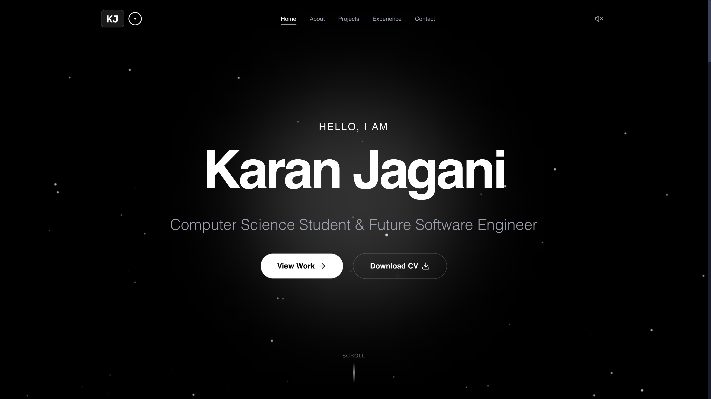

# Karan Jagani - Interactive Portfolio 🚀

A highly interactive, immersive personal portfolio website built with modern web technologies. This project features physics-based animations, 3D face-tracking interactions, and a dynamic starfield background to create a unique user experience.

 

## ✨ Features

- ** immersive 3D Experience**:
    - **Starfield Background**: A dynamic, warp-speed enabled starfield that reacts to user interaction.
    - **Face Tracking**: Uses your webcam (locally processing via MediaPipe) to control the parallax effect and cursor interaction 🤯. *Privacy focused: No video data leaves your device.*
- **Physics-Based Animations**: Powered by **Framer Motion**, every element feels alive with smooth spring animations, magnetic buttons, and layout transitions.
- **Sound Design**: Integrated sound effects for startup, clicks, and interactions for a multi-sensory experience.
- **Dynamic Projects Showcase**: Filterable project grid with expandable details using shared layout animations.
- **Responsive Design**: Fully optimized for mobile, tablet, and desktop devices.

## 🛠️ Tech Stack

- **Core**: [React 19](https://react.dev/), [Vite](https://vitejs.dev/)
- **Styling**: [Tailwind CSS](https://tailwindcss.com/)
- **Animations**: [Framer Motion](https://www.framer.com/motion/)
- **3D & AI**: 
    - [React Three Fiber](https://docs.pmnd.rs/react-three-fiber) (3D rendering)
    - [MediaPipe](https://developers.google.com/mediapipe) (Face Tracking)
- **Routing**: [React Router](https://reactrouter.com/)
- **Icons**: [Lucide React](https://lucide.dev/)

## 🚀 Getting Started

### Prerequisites

- Node.js (v20+ recommended)
- npm or yarn

### Installation

1.  **Clone the repository**
    ```bash
    git clone https://github.com/yourusername/portfolio.git
    cd portfolio
    ```

2.  **Install dependencies**
    ```bash
    npm install
    ```

3.  **Run the development server**
    ```bash
    npm run dev
    ```

4.  **Build for production**
    ```bash
    npm run build
    ```

## 📂 Project Structure

```
src/
├── components/
│   ├── 3d/           # Three.js & Face tracking components
│   ├── layout/       # Navbar, Footer, MainLayout
│   └── ui/           # Reusable UI components (ProjectCard, MagneticButton, etc.)
├── config/           # Site data and configuration
├── context/          # React Context (Sound, Starfield)
├── pages/            # Page components (Home, About, Projects, etc.)
├── utils/            # Helper functions
└── assets/           # Images, sounds, and global styles
```

## 🔒 Privacy Note

This portfolio uses the `FaceTracker` component to enable head-movement parallax effects. **All processing is done locally in your browser** using MediaPipe. No video feed or facial data is ever recorded, stored, or sent to any server.

## 📄 License

[MIT](LICENSE)
